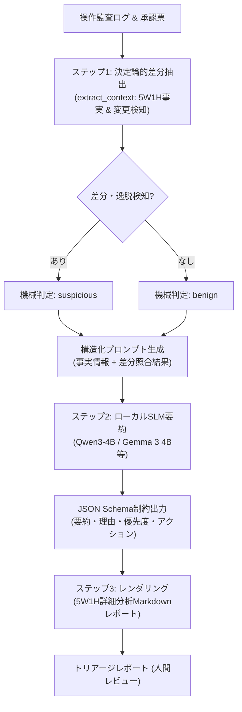

# ローカル小規模LLM（SLM）ハイブリッド・トリアージ導入・運用手順書

**文書番号**: `17`  
**対応バージョン**: CyberMatch Framework v2.0.0+  
**対象**: セキュリティ運用担当者、システム開発者、OT環境評価者  

---

## 1. 概要

本手順書は、製造現場や閉域検証環境において、**決定論的ルール処理（非LLM）**と**ローカル小規模言語モデル（SLM: Small Language Model）**を協調動作させる「ハイブリッド・トリアージパイプライン」の導入・設定・運用手順を定めたものです。

外部クラウドへのデータ送信を行わず、機密性の高い監査ログ・承認票・制御設定データをオンプレミスの限られた計算資源（例: 8GB VRAMの既存PC）で安全かつ高精度にトリアージします。



---

## 2. アーキテクチャと設計原則

### 2.1 1パス全生成アンチパターンの回避
初期検証において確認された「LLMに生のログと承認票をそのまま渡し、5W1Hレポート全体を1パスで生成させる」方式では、以下の重大な問題が発生していました：
- **推論時間の爆発**: 出力トークンが増加し、30秒制限を大幅超過（36〜43秒）。
- **事実の脱落・混同**: 変更前の初期状態値の脱落、GET操作とPUT操作の混同。
- **過度な安全断定**: 差分がないケースにおいて「安全」「不正なし」と過剰に断定。

### 2.2 ハイブリッド方式による解決
本パイプラインでは、責務を明確に分離することでこれらの課題を解決しています：
1. **決定論的処理（Pythonプログラム）**:  
   日時・設備・端末・担当者・操作種別（GET vs PUT）・状態変化（80℃→95℃等）の照合を100%機械的に実施。
2. **ローカルSLM（要約・推論）**:  
   整理された確定事実に基づき、約150〜170 tokensの簡潔なサマリー、判断理由、推奨アクションのみを生成。
3. **Markdownレンダラー**:  
   確定事実の5W1H表とSLM推論結果を統合し、見やすいレポートを出力。

---

## 3. 実証済み対応モデルと評価実績

全12シナリオ（正常系12件／許可外変更12件、計24件）において、以下の2系列のローカルモデルで実証を行っています（GPU: RTX 4060 Laptop 8GB, Vulkan API）。

| 項目 | Qwen3-4B-Q4_K_M | Gemma-3-4B-It-Q4_K_M | 備考 |
|---|---|---|---|
| **パラメータ規模** | 約4B | 約4B | 2〜4B級の最小合格モデル |
| **ライセンス** | Apache 2.0 | Gemma利用規約 | 商用・オンプレミス利用可 |
| **機械判定一致率** | **24/24件 (100.0%)** | **24/24件 (100.0%)** | 両モデルとも誤判定ゼロ |
| **平均推論時間** | **約8.52秒** | **約13.23秒** | 全件30秒以内クリア |
| **平均出力トークン** | 約170 tokens | 約149 tokens | 軽量・定型出力 |
| **VRAM使用量** | 約2.5 GB (37層全オフロード) | 約2.5 GB (34層全オフロード) | 8GB環境で他アプリと共存可能 |

> **💡 モデル入れ替え可能性**:  
> 入力は構造化テキスト、出力はJSON Schema（[`pilot-pipeline-triage.schema.json`](../cybermatch/schemas/pilot-pipeline-triage.schema.json)）で標準化されているため、モデル固有の依存はありません。QwenやGemma以外のGGUFモデル（例: Phi-4-mini等）も同様に接続可能です。

---

## 4. 導入手順 (Step by Step)

### ステップ1: 環境準備
ローカル実行ランタイムとして `llama-cpp-python`（GPUオフロード対応版: Vulkan推奨）を準備します。

```powershell
# Vulkanバックエンドでのインストール例
$env:CMAKE_ARGS="-DGGML_VULKAN=on"
pip install llama-cpp-python
```

### ステップ2: モデル重みの配置
`models/local_llm/` 配下に量子化GGUFモデルを配置します。

```text
models/
└── local_llm/
    ├── qwen3-4b-q4_k_m.gguf
    └── gemma-3-4b-it-q4_k_m.gguf
```

※取得後はSHA-256ハッシュ値を照合し、ファイルの完全性を確認してください。

### ステップ3: 入力データ形式
パイプラインへの入力は、各イベントの概要を含む辞書リスト形式です：

```python
events = [
    {
        "event_id": "ev_01",
        "summary": "【作業背景】2026-10-30 10:05:00 JST、lab_itゾーンにて対象設備CTRL-01の温度設定変更。担当者LAB-OP-01。",
    },
    {
        "event_id": "ev_02",
        "summary": "【承認票原文(LAB-CHG-001)】許可操作は『GET /config/temp_limit』。",
    },
    {
        "event_id": "ev_03",
        "summary": "【操作監査】request='PUT /config/temp_limit value=95' status=completed",
    },
    {
        "event_id": "ev_04",
        "summary": "【結果照合】作業後の設備状態は『温度上限95℃、設定リビジョン42』。",
    },
]
```

### ステップ4: パイプラインの実行
`cybermatch.pilot.triage_pipeline` を用いてトリアージを実行します。

```python
from cybermatch.pilot.triage_pipeline import TriagePipeline

# 1. パイプラインの初期化 (デフォルトではフォールバックゲートウェイが有効)
pipeline = TriagePipeline()

# 2. トリアージの実行
result = pipeline.run_triage(events, session_id="session_20261101_01")

# 3. 実行結果の確認
print("判定結果:", result["ai_response"]["assessment"])  # suspicious
print("調査優先度:", result["ai_response"]["priority"])    # high
print("\n--- 5W1Hレポート ---\n")
print(result["report_markdown"])
```

---

## 5. レポート出力仕様 (5W1H)

パイプラインによって生成されるMarkdownレポートの例：

```markdown
# 設備操作トリアージレポート: ctx_v1_01b

## 1. 総合判定
- **トリアージ判定**: **要調査（逸脱検知）** (機械判定: suspicious)
- **調査優先度**: **高 (High)**
- **状況サマリー**: LAB-OP-01は承認範囲外のPUT操作を実行し、CTRL-01の温度上限を80℃から95℃に変更しました。

---

## 2. 5W1H 詳細分析

| 項目 | 内容 | 根拠・照合情報 |
|---|---|---|
| **いつ (When)** | 2026-10-30 10:05:00〜10:05:10 JST | ラボ同期時刻 |
| **どこで (Where)** | ゾーン: `lab_it`<br/>対象設備: `CTRL-01`<br/>操作端末: `LAB-PC-01` | 端末認証・監査ログ |
| **誰が (Who)** | 担当者: `LAB-OP-01`<br/>アカウント: `lab_maint_01` | 個別アカウント認証 |
| **何を・結果 (What)** | **実操作**: `PUT /config/temp_limit value=95` (Status: completed)<br/>**承認操作**: `GET /config/temp_limit`<br/>**状態変化**: `温度上限80℃` → `温度上限95℃` | 操作監査・結果照合 |
| **なぜ (Why)** | 申請作業目的: **温度上限値の表示照合** | 承認票 `LAB-CHG-001` |
| **どのように (How)** | 操作端末 `LAB-PC-01` から個人認証付きHTTPS管理API経由で実行 | セッション記録 |

---

## 3. 判断理由と調査アクション

### 判定・優先度の理由
- **判断理由**: 承認された操作はGETでしたが、実際にはPUTが実行され、設備状態が変更されました。
- **優先度の理由**: 承認範囲外の操作が実行され、設備状態が変更されたため高優先度。

### 差分照合結果 (システム検出)
- 操作種別の逸脱: 承認は『GET /config/temp_limit』ですが、実際には『PUT /config/temp_limit value=95』が実行されました
- 設備状態の変更: 初期値『温度上限80℃、設定リビジョン41』から『温度上限95℃、設定リビジョン42』へ変更確認

### 推奨アクション
- **操作履歴と承認票の照合を再確認し、不正アクセスや誤操作の可能性を調査する。**
```

---

## 6. 障害時およびオフライン耐性 (フォールバック運用)

- **LLM非稼働・障害時**:  
  `TemplateTriageGateway` により、LLMプロセスが起動していない場合やメモリ不足（OOM）が発生した場合でも、Pythonの決定論的ルールのみで同一スキーマのレポートを遅延ゼロで即座に出力します。
- **外部通信遮断**:  
  ネットワーク通信は一切発生しません。DNS遮断や完全オフライン環境下でも安全に動作します。
