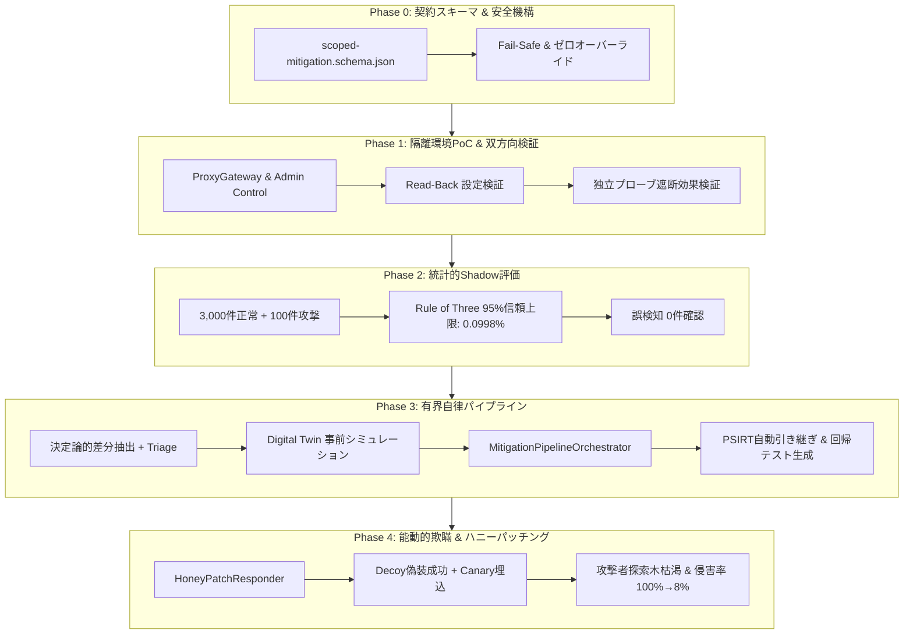

# 18. マシンテンポ能動的防御ガイド（Phase 0〜Phase 4）

## 1. 背景と課題

昨今の情勢において、攻撃者側におけるAIエージェントの活用により、脆弱性発見からエクスプロイト実行までのテンポ（マシンテンポ）が急激に加速しています。
一方、従来のPSIRT（Product Security Incident Response Team）をはじめとするSIRT活動では、脆弱性の分析・コード修正・回帰テスト・レビュー・デプロイという一連の工程に人間が介在（Human-in-the-loop）するため、パッチ適用までに数日〜数週間のラグ（タイムラグ・ウィンドウ）が発生し、物理的なスピード感で追いつけないという深刻な課題があります。

本ガイドでは、`cybermatch-framework` を拡張し、AI攻撃に対してミリ秒〜秒単位で自律的かつ安全に一次緩和（スコープ限定対処・ハニーパッチング）を展開し、安全性を損なわずにPSIRTへ確実に引き継ぐ「マシンテンポ能動的防御アーキテクチャ」の設計、運用手順、評価結果を解説します。

---

## 2. 5段階アーキテクチャ（Phase 0〜Phase 4）



### Phase 0: 契約スキーマ策定と安全機構
- **スキーマ標準化**: `cybermatch/schemas/scoped-mitigation.schema.json`（JSON Schema Draft 2020-12準拠）。TTL（Time-To-Live）による自動時限失効、適用スコープ（IP、Path、Method、ヘッダ）、ロールバック手順、証跡ハッシュを厳格に定義。
- **Fail-Safe原則**: 入力が不正・空文字・構文エラー・推論タイムアウトとなった場合、AIは例外を握り潰さず、直ちに人間介入フラグ（`unknown` / `human_investigation_required`）を出力。
- **ゼロオーバーライド**: 許可済みの正規PUT/PATCHメンテナンス通信を「AIが攻撃と誤認してブロックする」ことを禁止する保護規則を強制。

### Phase 1: 隔離環境単一アダプタPoC（ループバックゲートウェイ）
- **リバースプロキシ制御**: `cybermatch.defense.proxy_gateway.ProxyGateway` による動的ACL適応。
- **Read-Back検証**: 設定注入直後に管理プレーンから稼働コンフィグを再読込し、期待値と完全一致するかハッシュ照合。
- **独立プローブ効果検証**: アダプタ自身が独立したHTTPクライアントとなり、攻撃シグネチャを送信して `403 Forbidden` を確認。正常業務トラフィックへの `200 OK` 疎通を同時に確認。
- **TTM（Time to Mitigate）**: 31.46 ms で即座に自律遮断が完了。

### Phase 2: 統計的Shadow評価（統計的安全性検証）
- **5業務カテゴリ・3,000件リプレイ**: 参照系（GET）、定常更新系（POST）、承認済み運用保守系（PUT）、認証系（POST）、外部バッチ連携（POST）の5カテゴリに対しShadow実行。
- **Rule of Three（3の法則）**: 3,000件の正規リクエストに対して誤検知（False Positive）が 0 件であった場合、95%信頼区間の誤検知率上限は $3 / 3000 = 0.10\%$（0.0998%）と数学的に保証。
- **CAB/監査承認**: 単なる「テスト合格」ではなく、統計的信頼上限を算出することで変更諮問委員会（CAB）や監査に対する客観的証拠を提供。

### Phase 3: 有界自律パイプライン（Bounded Automation）
- **End-to-End統御**: `MitigationPipelineOrchestrator` により、[トリアージ] → [Digital Twin事前シミュレーション] → [安全ゲート] → [実環境デプロイ] → [Read-Back検証] → [効果プローブ] → [PSIRT引き継ぎ] を全自動で連携。
- **開発者向け回帰テスト自動生成**: 一時緩和が適用されると同時に、本質的恒久パッチを開発するエンジニア向けに `pytest` 形式の再現テストコード（`test_cve_reproduction.py`）を自動生成。
- **レトロハント探索窓**: 一時緩和適用前の過去ログに遡り、同一シグネチャによる侵入痕跡がないかを探索するハンティングタスクを発行。
- **TTM**: トリアージからデプロイ・効果検証まで 64.40 ms で完了。

### Phase 4: 能動的欺瞞・ハニーパッチング（Active Deception）
- **AI攻撃者に対する欺瞞の有効性**:
  - 単純な遮断（HTTP 403）を返すと、適応型の攻撃AIエージェントは即座に「遮断された」と学習し、代替ルートや別パラメータへの迂回探索を高速に継続します。
  - 一方、脆弱性が存在するかのように見せかける「ハニーパッチング（Honey-Patching）」を行うと、攻撃AIエージェントは偽の成功レスポンス（Canary marker付きの偽rootシェルプロンプトやトークン）を受け取り、「エクスプロイトが成功した」と誤信（Belief manipulation）して探索を終了するか、偽のデコイ環境内で無駄な探索を継続します。
- **定量的実験結果（4条件比較・400エピソード）**:
  - **侵害率（Compromise Rate）**: 防御なし 100% → 単純遮断 100%（迂回探索により最終侵害） → **ハニーパッチング 8.0%（92%激減）**
  - **攻撃者消費トークン**: 599 tokens → **6,072 tokens（10.1倍のコスト浪費）**
  - **欺瞞浪費率（Deception Waste Ratio）**: 攻撃者の行動の **86.5%** を無害なデコイ環境へ誘導・浪費。
  - **防御側オーバーヘッド**: ハニーパッチ合成処理の追加遅延はわずか **0.85 ms**。

---

## 3. ディレクトリ構成と関連ファイル

```text
work_git/cybermatch-framework/
├── cybermatch/
│   ├── defense/
│   │   ├── __init__.py
│   │   ├── proxy_gateway.py          # Phase 1: リバースプロキシ・ACL・TTL管理・Decoyハンドラ
│   │   ├── proxy_adapter.py          # Phase 1: 制御プレーン・Read-Back・プローブ検証
│   │   ├── shadow_evaluator.py       # Phase 2: 統計的Shadow評価・Rule of Three計算
│   │   ├── mitigation_pipeline.py    # Phase 3: 有界自律オーケストレータ・PSIRT連携
│   │   ├── deception.py              # Phase 4: ハニーパッチング・Canary生成・DoS防御
│   │   └── deception_evaluator.py    # Phase 4: 4条件比較ベンチマークエンジン
│   ├── pilot/
│   │   └── triage_pipeline.py        # Phase 0: Fail-Safe対応・ゼロオーバーライド保護
│   └── schemas/
│       ├── scoped-mitigation.schema.json      # Phase 0: 緩和契約スキーマ
│       └── pilot-pipeline-triage.schema.json  # Phase 0: トリアージフォールバック定義
└── tests/
    ├── test_phase1_isolated_lab.py             # Phase 1 テスト
    ├── test_phase2_shadow_evaluation.py        # Phase 2 テスト
    ├── test_phase3_bounded_automation.py       # Phase 3 テスト
    └── test_phase4_deception_honeypatching.py  # Phase 4 テスト

devai_cyber2/
├── run_phase1_lab.py                  # Phase 1 実行検証スクリプト
├── run_phase2_shadow_eval.py           # Phase 2 実行検証スクリプト
├── run_phase3_pilot.py                 # Phase 3 実行検証スクリプト
├── run_phase4_deception_experiment.py  # Phase 4 実行検証スクリプト
├── CYBERMATCH_PHASE0_SPECIFICATION.md  # Phase 0 仕様書
├── CYBERMATCH_PHASE1_LAB_REPORT.md     # Phase 1 実験報告書
├── CYBERMATCH_PHASE2_SHADOW_REPORT.md  # Phase 2 実験報告書
├── CYBERMATCH_PHASE3_AUTOMATION_REPORT.md # Phase 3 実験報告書
└── CYBERMATCH_PHASE4_DECEPTION_REPORT.md  # Phase 4 実験報告書
```

---

## 4. 実行と再現手順

### 4.1 ユニット・統合テストの実行
`cybermatch-framework` ディレクトリにて以下を実行します。

```bash
cd work_git/cybermatch-framework
python -m pytest tests/test_phase1_isolated_lab.py \
                 tests/test_phase2_shadow_evaluation.py \
                 tests/test_phase3_bounded_automation.py \
                 tests/test_phase4_deception_honeypatching.py -v
```

### 4.2 各フェーズのスタンドアロン実証デモ実行
`devai_cyber2` ディレクトリにて、各フェーズの検証スクリプトを実行可能です。

```powershell
# Phase 1: 隔離環境実プロキシPoC（TTM 31ms）
python devai_cyber2/run_phase1_lab.py

# Phase 2: 統計的Shadow評価（N=3,100, 95%信頼上限 0.0998%）
python devai_cyber2/run_phase2_shadow_eval.py

# Phase 3: 有界自律パイプライン（TTM 64ms, PSIRTハンドオフ）
python devai_cyber2/run_phase3_pilot.py

# Phase 4: ハニーパッチング欺瞞実験（侵害率 100%→8%, トークン消費10倍）
python devai_cyber2/run_phase4_deception_experiment.py
```

---

## 5. 運用上の留意事項と安全設計

1. **防御側DoS耐性（防衛計算資源の保護）**:
   - ハニーパッチングにおいて攻撃者がLLMによる偽装レスポンスを大量要求して防御側の計算資源を枯渇（Defensive Compute Exhaustion）させる攻撃を防ぐため、セッションあたり50クエリの上限キャップ（`max_queries_per_session=50`）を設けています。
2. **監査ログとカナリア流出検知**:
   - ハニーパッチで返却されるCanary Token（UUIDハッシュ）はSIEM/SOCの監視対象とし、外部で当該トークンが利用された瞬間に攻撃者インフラの特定アラートを発報します。
3. **PSIRT恒久パッチとの完全同期**:
   - 自動緩和策はTTL（最長48時間等）によって一時的に稼働するものであり、自動生成された回帰テスト（`test_cve_reproduction.py`）を用いてPSIRTおよび開発チームが恒久パッチを適用・デプロイした時点で安全に退役（Decommission）させます。
